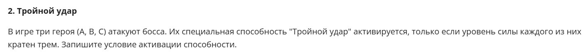
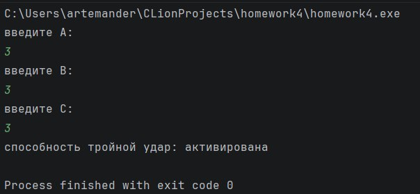
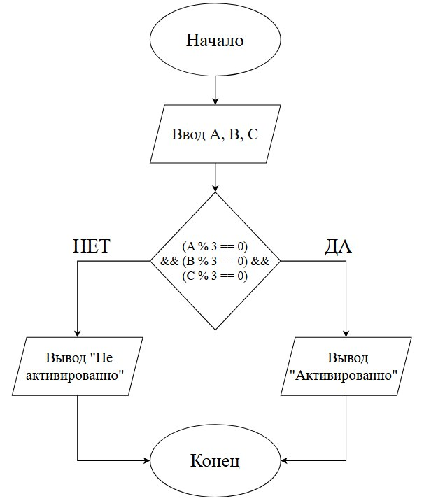

# Домашнее задание к лабораторной работе №4

**Вариант:** 2

## Задание
Реализовать программу для решения следующей задачи



## Код программы

```c
#include <stdio.h>
#include <locale.h>

int task(int A, int B, int C);

int main() {
    setlocale(LC_ALL, "RUS");

    int A, B, C, result;
    printf("введите А: \n");
    scanf("%d",  &A);
    printf("введите B: \n");
    scanf("%d", &B);
    printf("введите C: \n");
    scanf("%d", &C);

    result = task(A, B, C);

    printf("способность тройной удар: %s\n", result ? "активирована" : "не активированна"  );

    return 0;
}

int task(int A, int B, int C) {
    return ((A % 3 == 0) && (B % 3 == 0) && (C % 3 == 0)) ? 1 : 0;
}
```

## Пример работы программы



## Схема draw.io:


## Вывод

В ходе решения данной задачи я научился записывать сложные логические условия на языке C. 

Выяснил, что для проверки кратности числа трем используется оператор остатка от деления `%`. Условие активации способности требует одновременного выполнения трех проверок, поэтому в коде применяется логический оператор «И» (`&&`).

Также задачу выполнил без условного оператора **`if`**, а вместо него применил тернарный оператор `? :`, который позволяет компактно возвращать результат проверки.

