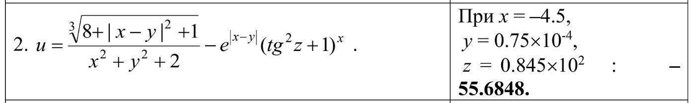
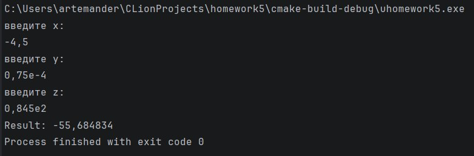
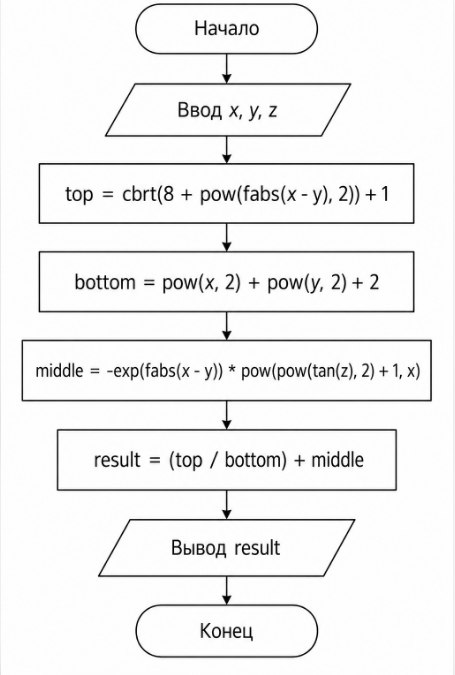

# Домашнее задание к лабораторной работе №5

**Вариант:** 2

## Задание
Создать программу вычисления указанной величины.
Результат проверить при заданных исходных значениях.



## Код программы

```c
#include <stdio.h>
#include <math.h>
#include <locale.h>

double u(double x, double y, double z);

int main () {
    setlocale(LC_ALL, "RUS");
    double x, y, z;

    printf("введите x: \n");
    scanf("%lf", &x);

    printf("введите y: \n");
    scanf("%lf", &y);

    printf("введите z: \n");
    scanf("%lf", &z);

    printf("Result: %lf", u(x, y, z));
    return 0;
}

double u(double x, double y, double z) {
    double top = cbrt(8 + pow(fabs(x - y), 2) + 1);
    double bottom = pow(x, 2) + pow(y, 2) + 2;
    double middle = 0 - exp(fabs(x - y)) * pow((pow(tan(z), 2) + 1), x);

    return (top / bottom) + middle;
}
```

## Пример работы программы



## Схема draw.io:


## Вывод

В ходе выполнения домашнего задания я научился реализовывать сложные математические формулы на языке C с использованием стандартной библиотеки `<math.h>`. 

Были изучены и применены на практике следующие функции:
- `cbrt()` для извлечения кубического корня;
- `pow()` для возведения в степень;
- `fabs()` для вычисления модуля;
- `exp()` для вычисления экспоненты;
- тригонометрическая функция `tan()`.

Также я отработал навыки работы с вещественными числами типа `double`, настройки ввода-вывода с помощью `scanf` и `printf`, а также оформления отчета и кода в системе контроля версий GitHub.

Программа успешно компилируется и выдает результат, соответствующий эталонному значению из методички
